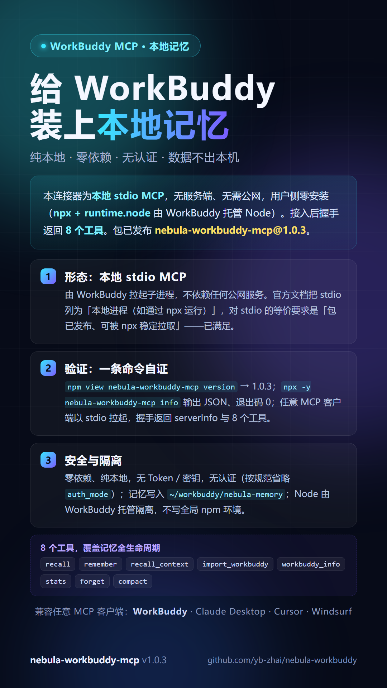

# nebula-workbuddy-mcp



> 作者：**yb-zhai** ｜ 仓库：<https://github.com/yb-zhai/nebula-workbuddy>

**记忆星云的 WorkBuddy 版 MCP Server** —— 零依赖、纯本地、离线可用的 Agent 长期记忆，
通过标准 MCP（stdio JSON-RPC 2.0）接进 WorkBuddy，并把 WorkBuddy 自己的历史会话导进记忆库。

引擎与 [nebula-memory-mcp](https://github.com/yb-zhai/agent-memory) 完全相同（四臂召回：词频 + 倒排 + 图扩散 + 时间衰减），
区别只在「为 WorkBuddy 做了哪三件事」：

| | 通用版 `nebula-memory-mcp` | 本版 `nebula-workbuddy-mcp` |
|---|---|---|
| 记忆库默认位置 | `~/.agent-memory` | `~/.workbuddy/nebula-memory`（跟着 WorkBuddy profile 走） |
| 工具描述 | 通用 | 按 WorkBuddy Agent 的中文语境重写，强调「动手前先 recall」 |
| WorkBuddy 历史 | 无 | `import_workbuddy`：导入 memory.md + 本地会话 transcript；`workbuddy_info`：探测路径与导入水位 |

## 一、接入

**不用下载、不用预装 Node、不用注册、不用认证。** 三步搞定。

### 方式 A：WorkBuddy 界面添加（推荐，约 30 秒）

打开 WorkBuddy →「**MCP 服务管理**」→ 右上「**+ 添加 MCP**」，填：

```
名称：nebula-memory
命令：npx
参数：-y nebula-workbuddy-mcp
```

保存后**重启 WorkBuddy**，在 MCP 列表看到 `nebula-memory` 是**绿色、8/8 工具已启用**即成功。

> **环境变量不用填。** 记忆库默认落在 `~/.workbuddy/nebula-memory`
> （代码：`process.env.NEBULA_DATA_DIR || path.join(workbuddyHome(), 'nebula-memory')`）。

### 方式 B：直接改 `~/.workbuddy/mcp.json`

已有其他 MCP 的话，把 `nebula-memory` 这一条合并进现有的 `mcpServers`：

```json
{
  "mcpServers": {
    "nebula-memory": {
      "command": "npx",
      "args": ["-y", "nebula-workbuddy-mcp"]
    }
  }
}
```

### 方式 C：本地源码（要改代码或锁定版本时用）

```powershell
git clone https://github.com/yb-zhai/nebula-workbuddy.git
cd nebula-workbuddy

# 1. 写进 ~/.workbuddy/mcp.json（自动备份原文件，只动自己那一条）
node install.mjs

# 2. 导入 WorkBuddy 最近 90 天的历史（幂等，重复跑只跳过不重复写）
node mcp-server.mjs import --days 90

# 3. 按 WorkBuddy 实际使用的配置验证握手 + 召回
node handshake.mjs --query "上次那个问题" --query "我的偏好"
```

这种方式写入的是**绝对路径**（`process.execPath` + 本机脚本路径），
好处是版本完全由你控制，坏处是换机器要重装。卸载：`node install.mjs --uninstall`
（记忆库目录保留，删不删随你）。

### 确认装好了没

```powershell
npx -y nebula-workbuddy-mcp info
```

能输出一段 JSON（含 `workbuddy.home` / `memory.dir` 等路径）且不报错，就说明包本身没问题；
再重启 WorkBuddy，看 MCP 列表里的状态灯。

## 二、工具

| 工具 | 作用 | 关键参数 |
|---|---|---|
| `recall` | 跨会话召回 | `query`、`limit`、`kind`、`tag`、`namespace` |
| `remember` | 写入长期记忆 | `text`、`kind`、`importance`（1.0=永久不衰减）、`tags` |
| `recall_context` | 召回并压成可直接注入上下文的记忆块 | `query`、`maxChars` |
| `stats` / `forget` / `compact` | 统计 / 按 id 删除 / 压缩库文件 | — |
| `import_workbuddy` | 导入 WorkBuddy 历史 | `days`、`maxSessions`、`force`、`dryRun` |
| `workbuddy_info` | 探测 WorkBuddy 路径 + 导入水位 + 记忆库位置 | — |

所有工具都支持可选 `namespace`：不填=默认库；填了=独立子库（如按项目隔离），互不干扰。

## 三、导入的是什么（只读 WorkBuddy，不改它任何文件）

1. **会话标题** → `fact`，importance 0.7（「这件事干过」的索引）
2. **用户原话** → `episode`，importance 0.55。会先剥掉 WorkBuddy 包在用户消息外面的
   system-reminder / 项目上下文 / 工具回显，只留 `<user_query>` 里的真实输入。
3. **助手收尾回答** → `episode`，importance **0.18**（原 0.35，实测会挤占召回前排，压到 0.18 后
   top5 里助手占比从 21% 降到 13%），只留开头 500 字。
   回答后面还跟着工具调用的「我先查一下」这类前导语会被丢掉（不是结论）。
4. **`~/.workbuddy/memory/<uid>_memory.md` 的记忆条目** → `profile`，importance 0.95。

同一 transcript 内相邻消息会连一条时间线边（`source: workbuddy.timeline`），
让一个会话在召回里成为可扩散的簇，而不是一堆孤点。

> ⚠️ **一个会话可能对应多份 transcript**：WorkBuddy 迁移 workspace（`C:\Users\...\WorkBuddy` →
> `D:\WorkBuddy\Workspaces`）后，同一 `sessionId` 在两个项目目录下各留一份文件，时间区间不重叠。
> 导入以**文件**为单位，两份都会导，重叠的对话由引擎去重合并——按 `sessionId` 去重会丢掉后半段历史。
> 本机实测：28 份文件对应 22 个会话。

### 压低助手消息：试过的手段与结论

| 手段 | 助手占 top5 | 关键结论 | 判定 |
|---|---|---|---|
| importance 0.35（初版） | 21.3% | 全在 | 太抢 |
| **importance 0.18（当前）** | **13.0%** | 全在 | ✅ 采用 |
| importance 0.10 | 11.1% | 全在，但出现空结果（跌破 `minScore`） | ❌ |
| assistantChars 250 | 17.4% | 全在 | ❌ 截断提纯，反而升权 |
| 每会话只留最后 2 条 | 6.5% | **全丢**（结论多在会话中段） | ❌ |
| 结论标记过滤 | 10.9%→15.2% | 全在 | ❌ 无净收益，留作 `assistantFilter: 'conclusion'` 可选项 |

结论：权重只能压到 0.18；再往下、改字数、按位置截断都会伤到有效信息。
关键词过滤能把 107 条噪声助手消息去掉（867→760 节点），但因为语料 idf 变化，
助手在 top5 的占比反而升到 15.2%，对「用户意图优先」没有净收益，所以默认关闭。

### LLM 抽取结论（最终采用的方案）

对 22 个会话跑 LLM 抽取（29 个并行任务），产出 60 条带原文证据的结论，叠加进库：
`kind=fact`、`importance=0.6`、`tag=llm-distilled`、`meta.evidence` 存原文。基线 867 节点全留作长尾。

| 指标 | 基线 | 叠加后（最终） |
|---|---|---|
| top5 助手占比 | 13.0% | **4.2%** |
| top1 是助手 | 1/10 | **0/10** |
| 空结果 | 0 | 0 |

权重选择经过实测：0.85 有语义漂移（「培训记录 共享盘」被「账号表不在共享盘」抢 top1）；
1.0 会跳过时间衰减造成过拟合（「显卡 驱动 设置」答非所问）；**0.6 消除漂移且指标不变**。
时间戳保留为导入当天（不回拨）：实测回拨到证据时间会让老结论被衰减、助手占比反弹到 6.5%。
加边实验（结论→证据原文）也无净收益，故未采用。

- 抽取产物：`_bench/llm-full/extract-verified.json`（60 条，证据 60/60 可逐字回溯）
- 备份：`_bench/llm-full/backup-pre-optimize`（抽取叠加后、权重调整前）
- 回滚：把备份目录复制回 `~/.workbuddy/nebula-memory` 即可

### 引擎召回效果正式测试（LongMemEval）

WorkBuddy 版用的是记忆星云引擎的副本，可跑主项目的标准评测验证引擎本身没有退化：

```powershell
cd E:\DSHN\build\DSH-memory-nebula
node scripts/eval-longmemeval.mjs --data=D:/cache/temp/longmemeval_oracle.json --mode=local --bench
node scripts/eval-longmemeval.mjs --freshness --mode=local
```

2026-11-26 实测（500 题 + 写入→可召回延迟）：

| 指标 | 结果 |
|---|---|
| Recall@5 | **99.8%**（499/500） |
| MRR | 0.9497 |
| 最弱题型 | temporal-reasoning 99.2%（132/133），其余 5 类均 100% |
| 记忆新鲜度 | 4 / 1 / 2 ms，平均 **2ms**（3/3 轮） |
| 与 2026-11-23 基线 | 召回率、MRR 完全一致（引擎未被 WorkBuddy 改动） |

注意：这是**引擎层**基准，评测脚本从主项目 `DSH-memory-nebula` 加载引擎；WorkBuddy 版的
召回调参（importance、抽取结论叠加）另有 `_bench/eval-*.json` 的对照集，两者不要混为一谈。

幂等靠两层：状态文件 `.workbuddy-import.json` 记录每个 transcript 的 size/mtime；
引擎自身按内容相似度去重。

### 数据位置

| 内容 | 路径 |
|---|---|
| 记忆库（本插件写） | `~/.workbuddy/nebula-memory/`（nodes.jsonl / edges.jsonl / index.json） |
| 导入水位 | `~/.workbuddy/nebula-memory/.workbuddy-import.json` |
| 会话 transcript（只读） | `~/.workbuddy/projects/<slug>/<sessionId>.jsonl` |
| 会话元数据（只读，sqlite） | `~/.workbuddy/workbuddy.db` → `sessions` 表 |
| WorkBuddy 自带记忆（只读） | `~/.workbuddy/memory/<uid>_memory.md` |

## 四、验证

```powershell
node verify.mjs       # 端到端自检：临时库，握手 + 8 工具 + 写入召回 + 导入 + 错误路径
node handshake.mjs    # 按 ~/.workbuddy/mcp.json 的真实配置拉起服务再测一遍
node mcp-server.mjs info
```

- `verify.mjs` 用临时目录，**不碰**你的真实记忆库；
- `handshake.mjs` 读 `mcp.json` 里的 `command/args/env` 原样启动——它通过，等价于
  「WorkBuddy 按这份配置去拉服务」能过。

## 五、第三方评测

一份 15 页的独立评测，按**接入方式 / 运行方式 / 架构 / 数据链 / 维度 / 服务对象 / 内容 / 提炼 /
分库 / 存储 / 联网 / 召回 / 可解释性 / 实用性 / 用途**共 15 个维度拆解这个连接器，含本机实测：
评测时点 28 份会话 / 927 节点 · 944 边 · 3.44 MB、纯本地召回 p50 13 ms、LongMemEval 500 题 Recall@5 99.8%。

结论是同一句话：**用「纯文件 + 规则打分」换来可控、离线、零成本**，代价是纯词面召回的语义天花板
与约 10 万条的容量边界。

[下载评测 PPT（15 页）](https://github.com/yb-zhai/nebula-workbuddy/blob/master/docs/workbuddy-connector-review.pptx)

## 六、已知边界

- `workbuddy.db` 通过 `node:sqlite`（Node ≥22.5，实验特性）只读打开；打开失败（库被锁、
  Node 版本低）会自动降级为「只扫 transcript 目录」，标题缺失但不影响导入。
- WorkBuddy 运行中导入是安全的：它只读 transcript 和 sqlite（readOnly），写入的是自己的记忆库。
- 本版是**独立包**，引擎在 `memory/` 有副本。引擎改动请在 `nebula-memory-mcp` 那条线上做，
  然后 `node scripts/sync-engine.mjs` 同步过来（`--check` 只比对不写）。
- 已发布到 npm：`nebula-workbuddy-mcp@1.0.2`，可用 `npx -y nebula-workbuddy-mcp` 拉起。
  注意别和 npm 上的 `agent-memory`（他人占用的空壳包）、`agent-memory-mcp`（他人的同名项目）混淆。

## 许可

- 代码：MIT，见 [LICENSE](LICENSE)，`Copyright (c) 2026 yb-zhai`
- 素材（`docs/` 下的图片、`connector-submission/icon.svg`）：随项目 MIT，均为自产
- **二次创作（二创）约定**：基于本项目的衍生 / 改版 / 换皮作品，在 **GitHub 仓库、产品官网等公开渠道**上须附上原作者 GitHub 地址：<https://github.com/yb-zhai/nebula-workbuddy>，并标注明「基于 yb-zhai/nebula-workbuddy 修改」，简述改动
- **上游**：`memory/` 与 `shared/` 是 [yb-zhai/agent-memory](https://github.com/yb-zhai/agent-memory) 引擎的副本（同一作者，MIT），随本仓库一并分发；引擎改动请回到上游进行，再用 `node scripts/sync-engine.mjs` 同步
- **第三方**：本项目**零运行时依赖**（`dependencies` 恒为空）；可选的外部记忆后端遵循其自身许可，不随本仓库分发
